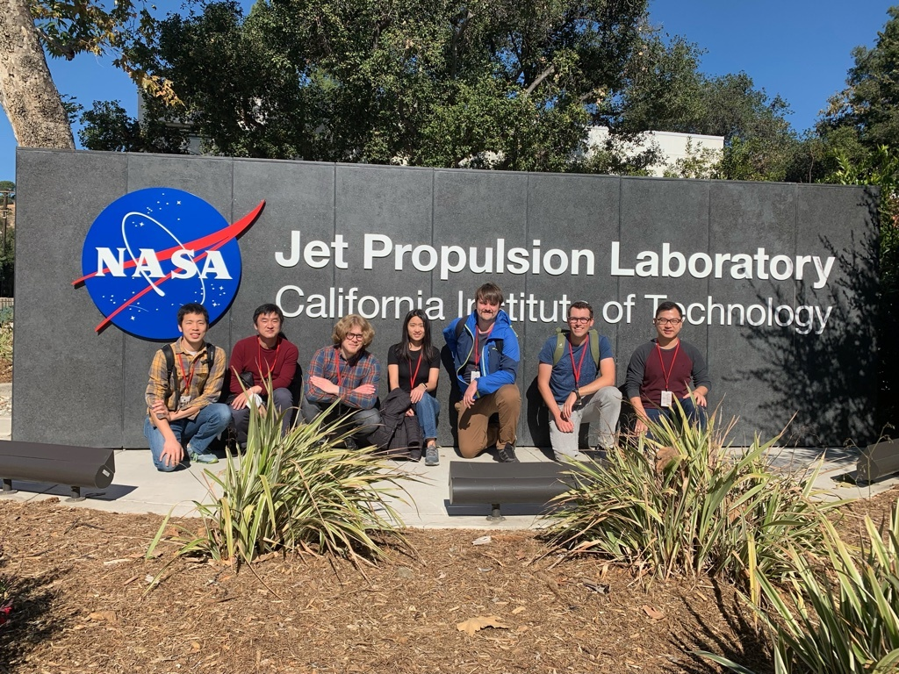

# Space geodesy · Lithospheric deformation

*   *   *

## About me
I am a postdoctoral researcher at the Department of Geophysics, Doerr School of Sustainability, Stanford University.

I am a geophysicist interested in how lithospheric processes and medium properties manifest as observable crustal deformation. My research integrates high-resolution spaceborne geodesy (primarily **InSAR** and **GNSS**) with seismological data to resolve the deformation continuum across diverse scales. I am interested in inverse problems that use optimization or stochastic sampling methods to infer the kinematics of faults, volcanoes, and plate rotations through analytical formulations and Boundary Element Modeling.

<strong>Research Interests:</strong>
geophysics
tectonic geodesy
seismic cycles
inverse problems

## News

- **[12/2026]** At AGU26:
  - Co-convening session G019 *Subduction Zone Deformation Throughout the Earthquake Cycle: Observations and Models* with Elizabeth Sherrill (GEOMAR) and Nicolás Castro Perdomo (Indiana University).
  - Talk in G021 (G21A-05) on a wide-area joint geodetic view of backarc deformation along the Peru–Chile margin.
  - Update on Sentinel-1/NISAR closure-phase work in the Kaweah Basin, CA.
- **[10/2026]** Our Bayesian co- and postseismic slip model of the 2023 Türkiye–Syria earthquake doublet, led by Leonid Pereiaslov, is out in [Seismological Research Letters](https://doi.org/10.1785/0220260122).
- **[09/2026]** Our study of the 2025 Santorini–Kolumbo earthquake swarm, led by John Wilding and Taiyi Wang, is out in [Science Advances](https://doi.org/10.1126/sciadv.aec3198). A dike intrusion triggered an Mw 6.2 aseismic slip transient on the Amorgos fault.
- **[08/2026]** Presented our soil closure-phase work in the Kaweah Basin, CA, at the IEEE IGARSS meeting in Washington, DC.
- **[04/2026]** Presented my [recent work on the Peru–Chile subduction zone](/research/#chile-insar) at the [SZ4D conference](https://www.sz4d.org/events/2026-sz4d-science-community-meeting) in Long Beach, CA.
- **[01/2026]** Started my postdoc at **Geophysics, Stanford**:
  - With Prof. [Howard Zebker](https://ee.stanford.edu/~zebker/index.html), advancing open-access ground displacement products for global volcano monitoring using Sentinel-1 and NISAR data.
  - With Prof. [Rosemary Knight](https://sustainability.stanford.edu/people/rosemary-knight), exploring what InSAR can tell us about surface and subsurface hydrological processes.
- **[12/2025]** Presented our Peru–Chile megathrust coupling work in the subduction zone deformation session at AGU25, New Orleans.
- **[10/2025]** *Defended my Ph.D. dissertation at the [Caltech Seismolab](https://www.seismolab.caltech.edu), under the mentorship of Profs. [Mark Simons](http://web.gps.caltech.edu/~simons/) and [Zach Ross](http://web.gps.caltech.edu/~zross/). Check out [my thesis](https://thesis.caltech.edu/17795/).*
{: .news}

## Education

+ Ph.D., Geophysics, California Institute of Technology, 2019--2025
  + Thesis: Space Geodetic Constraints on Plate Motion, Fault Creep, and Megathrust Coupling
  + Advisor: Mark Simons, Zach Ross

+ M.S., Earth Science and Engineering, KAUST, Saudi Arabia, 2016--2018
  + Thesis: Ground Deformation Related to Caldera Collapse and Ring-Fault Activity
  + Advisor: Sigurjón Jónsson
+ B.S., Geology; B.Eng., Civil Engineering, National Taiwan University, 2010--2015

## Experience

* **01/2026--present:** Postdoc, Geophysics, Stanford University
* **08/2019--10/2025:** Graduate researcher, Caltech Seismological Laboratory
* **08/2016--07/2018:** Master researcher, Crustal deformation & InSAR group, King Abdullah University of Science and Technology (KAUST, Saudi Arabia)
* 2015: Research assistant, Institute of Earth Sciences, Academia Sinica, Taipei, Taiwan

## Publications



## Media
Editor's highlight by EOS (AGU): [Mapping the Whereabouts of Continents
](https://eos.org/editor-highlights/mapping-the-whereabouts-of-continents)

*   *   *

**Please feel free to reach out to me!**

{:style="width: 60%;"}
> The Simons group at its peak size, around 2020–2022 during my PhD years, in front of JPL (2022). Left to right: me, Lijun Zhu, Leonid Pereiaslov, Yujie Zheng, Alex Berne, Tobias Köhne, Yunjun Zhang. Hmmm, where were Ollie, Rishav, and Théa?